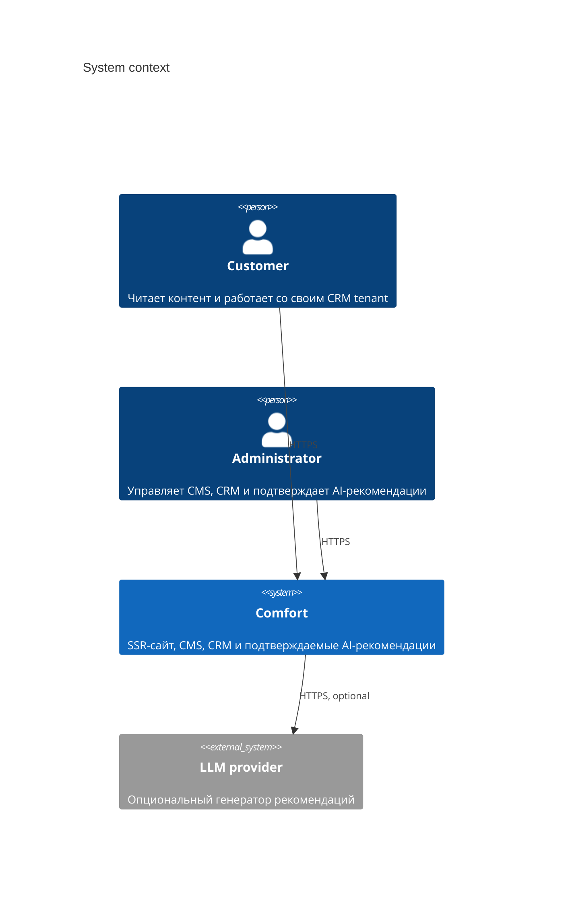
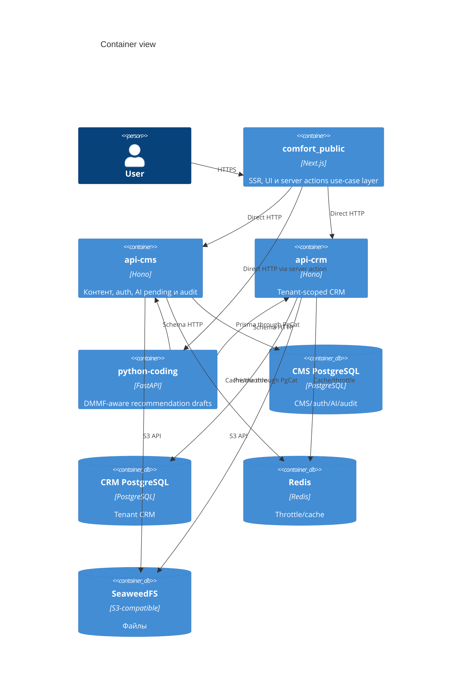
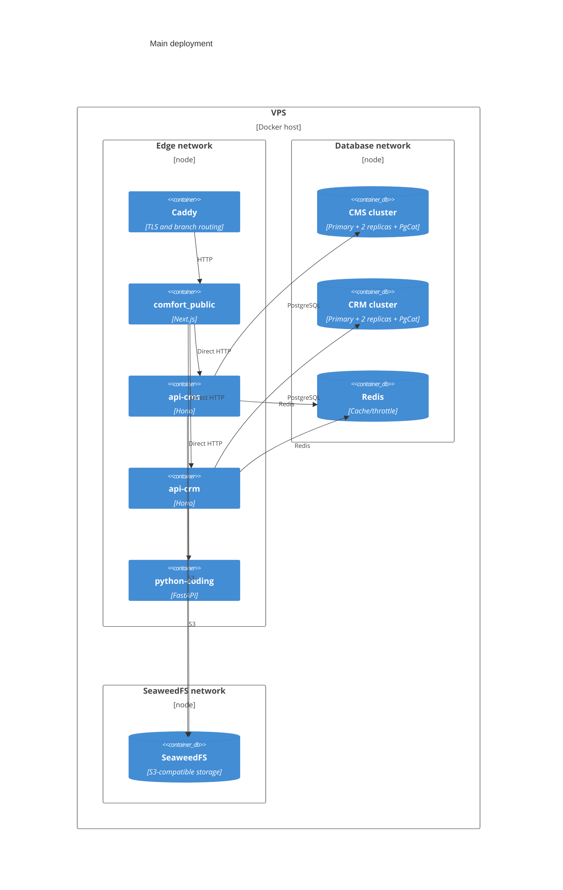

# C4: архитектура Comfort

Диаграммы описывают текущие границы. Стрелки между Next.js и API — прямые вызовы; отдельного
gateway/BFF нет.

## System context

## Container

## Deployment

В test/local CI каждый PostgreSQL-кластер заменяется одним узлом; границы баз и публичные
контракты не меняются.
